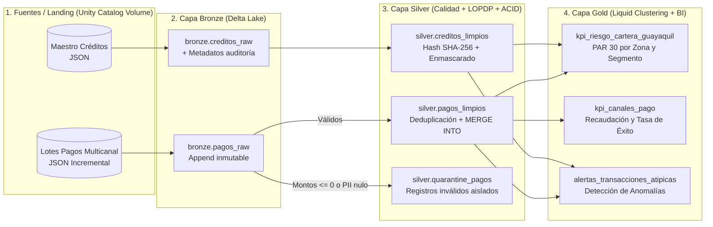
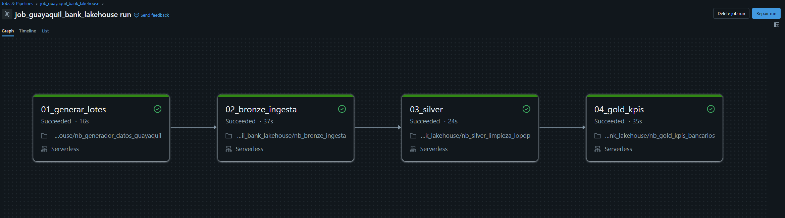
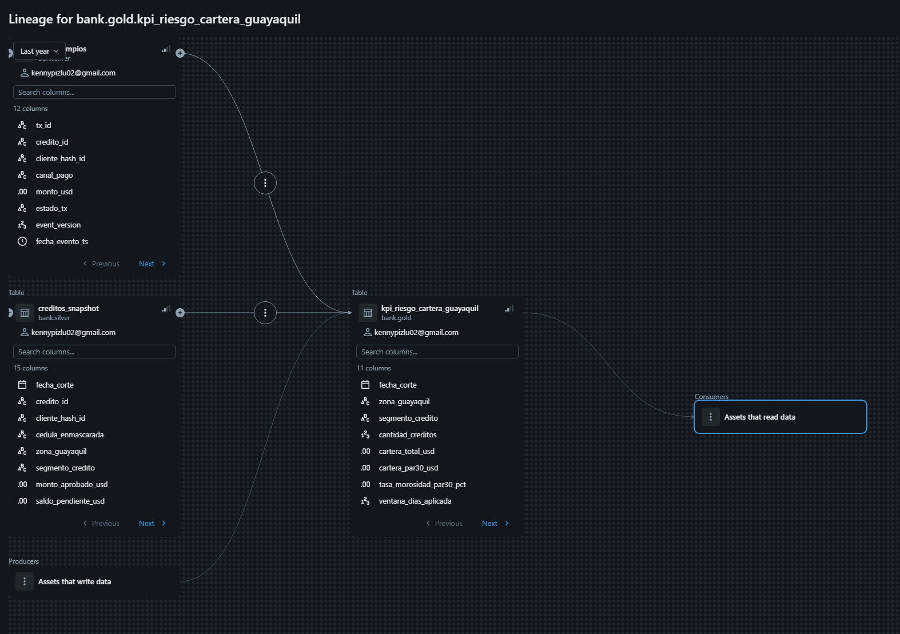
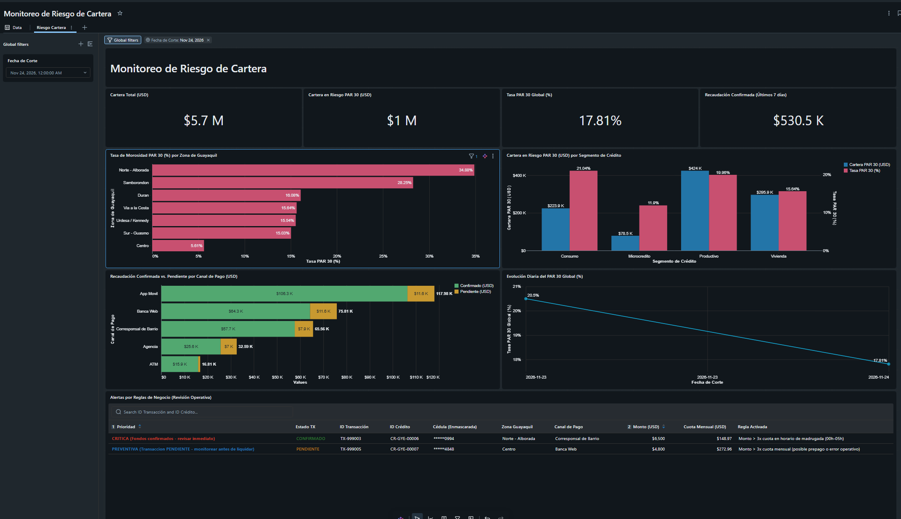

# Guayaquil Banking Lakehouse: Riesgo de Cartera

Pipeline **End-to-End en Databricks (Arquitectura Medallion)** diseñado para resolver desafíos reales de ingeniería de datos en la banca ecuatoriana: consolidación de pagos multicanal, cálculo de cartera en riesgo (mora mayor a 30 días) por zonas de Guayaquil, detección de transacciones atípicas y protección de datos personales conforme a la **LOPDP**.

---

## Problema de Negocio

Ante el crecimiento acelerado del crédito de consumo y microcrédito en Guayaquil, las áreas de Riesgos Crediticio enfrentan tres retos:
1. **Integridad contable en ingesta multicanal:** Los pagos provenientes de App Móvil, Banca Web, Agencias, ATMs y Corresponsales de Barrio pueden llegar duplicados, con montos inválidos o con cambios tardíos de estado (`PENDIENTE` -> `CONFIRMADO`).
2. **Visibilidad oportuna del riesgo geográfico:** Necesidad de monitorear la tasa de morosidad mayor a 30 días por sector de Guayaquil y alertar transacciones anómalas (por ejemplo, pagos inusuales de madrugada en corresponsales).
3. **Cumplimiento regulatorio y privacidad (LOPDP):** Impedir la exposición de cédulas de identidad en las capas de analítica y garantizar trazabilidad completa para auditorías de la Superintendencia de Bancos.

---

## Arquitectura y Flujo de Datos

---

## Desarrollo Técnico de Ingenieria de Datos

| Desafío Bancario | Solución Implementada en Databricks | Impacto |
| :--- | :--- | :--- |
| **Idempotencia en reprocesos** | `MERGE INTO` sobre `tx_id` en Delta Lake + deduplicación con `ROW_NUMBER()`. | Re-ejecutar un lote nocturno fallido genera **cero duplicados** y actualiza estados tardíos. |
| **Tolerancia a datos corruptos** | Patrón de **Cuarentena** (`silver.quarantine_pagos`) con columna `motivo_rechazo`. | Registros con montos negativos o cédulas nulas se aíslan para auditoría sin detener el cierre diario. |
| **Privacidad (LOPDP Ecuador)** | Hashing `SHA-256` con *salt* para llaves de cruce + enmascaramiento (`******5678`) y eliminación de cédula completa en Silver. | Los analistas y dashboards consumen datos confiables sin exposición de identificaciones. |
| **Rendimiento de consultas** | **Liquid Clustering** (`CLUSTER BY`) en tablas Gold + mantenimiento con `OPTIMIZE`. | Elimina el sobreparticionamiento y el problema de *small files* en consultas por zona y fecha. |
| **Gobernanza y Auditoría** | **Unity Catalog** (modelo de 3 niveles + Volumes) y **Delta Time Travel**. | Linaje automático columna a columna y capacidad de auditar estados históricos exactos. |

---

## Estrategia de Datos

Debido al sigilo bancario el pipeline utiliza un generador determinístico (`nb_generador_datos_guayaquil.py`) calibrado con los segmentos oficiales del sistema financiero ecuatoriano (**Consumo, Microcrédito, Productivo y Vivienda**, en USD) y sectores reales de Guayaquil, inyectando deliberadamente duplicados, registros corruptos y anomalías operativas para validar la resiliencia del flujo.

---

## Verificación de Ejecución en Databricks

### 1. Orquestación End-to-End (Databricks Jobs DAG)

### 2. Linaje Automático en Unity Catalog

### 3. Dashboard de Riesgo de Cartera y Alertas (AI/BI)

---

## Reproduce el Proyecto en tu Workspace de Databricks

1. Importar los notebooks de la carpeta `notebooks/` en un workspace de **Databricks Free Edition**.
2. Ejecutar la creación de schemas (`bronze`, `silver`, `gold`) y el Volume `landing_zone` dentro del catálogo `bank`.
3. Crear un **Databricks Job** encadenando los notebooks del `01` al `04` (con el parámetro `fecha_proceso = 2026-11-24` en la ingesta Bronze) y ejecutar el flujo.
